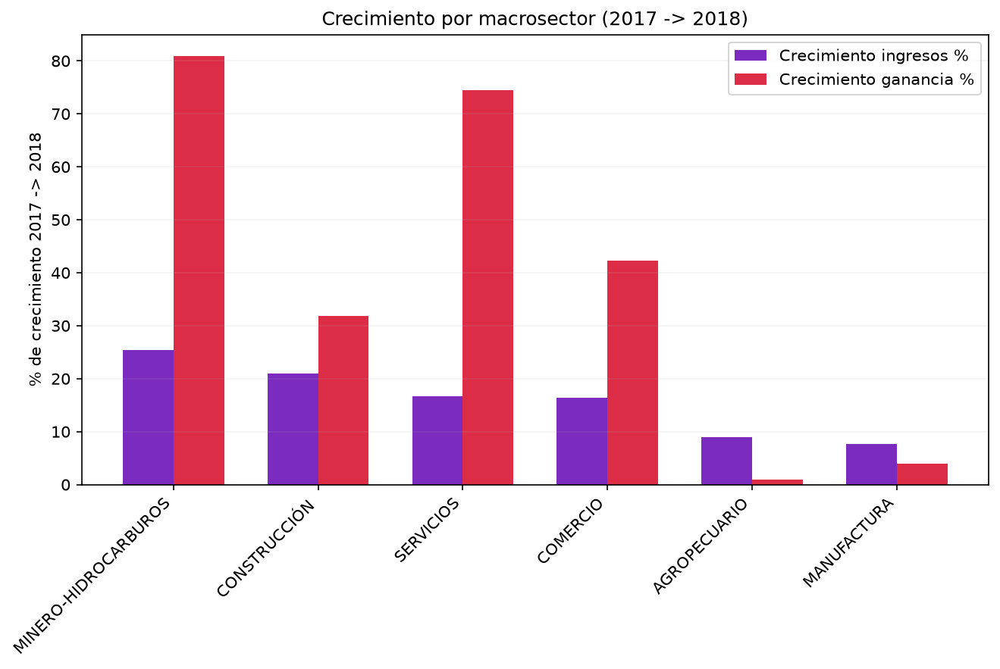
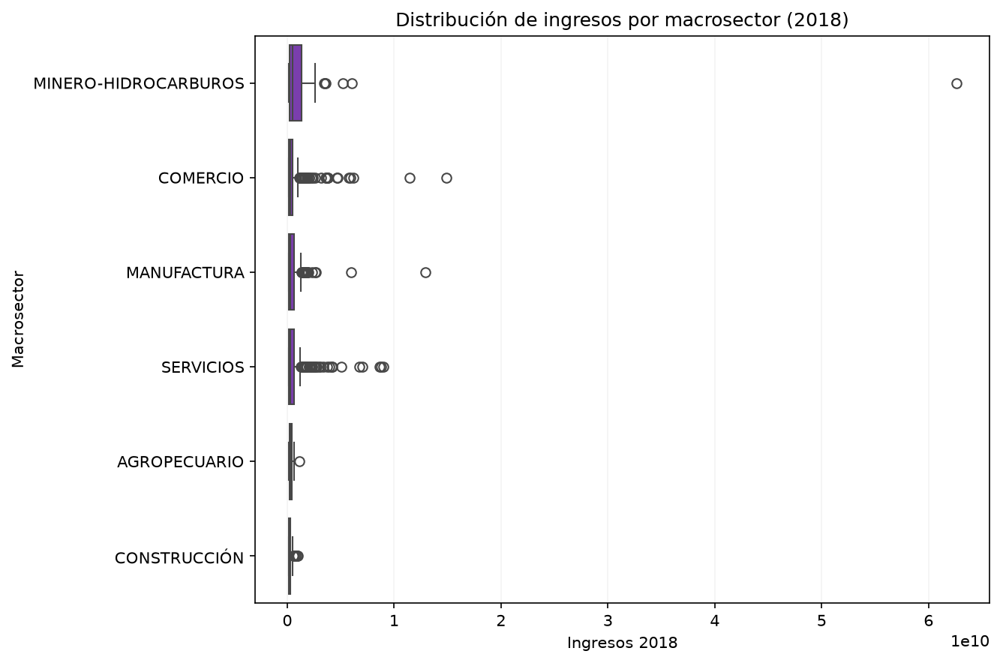
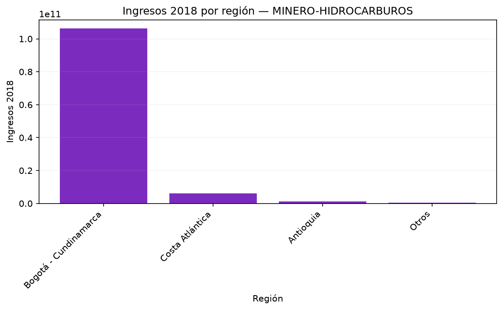
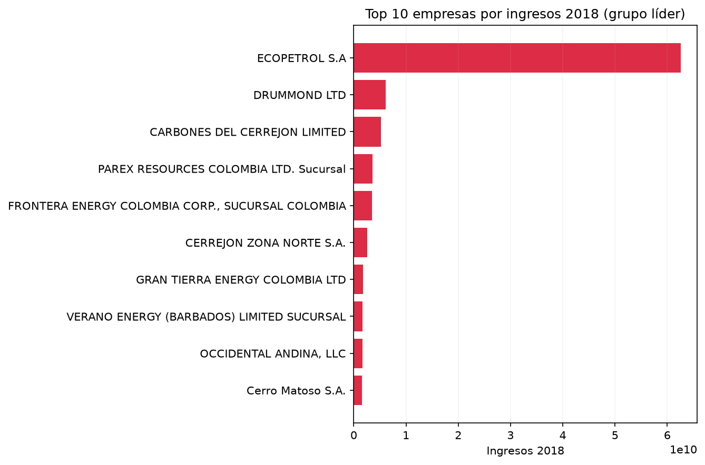
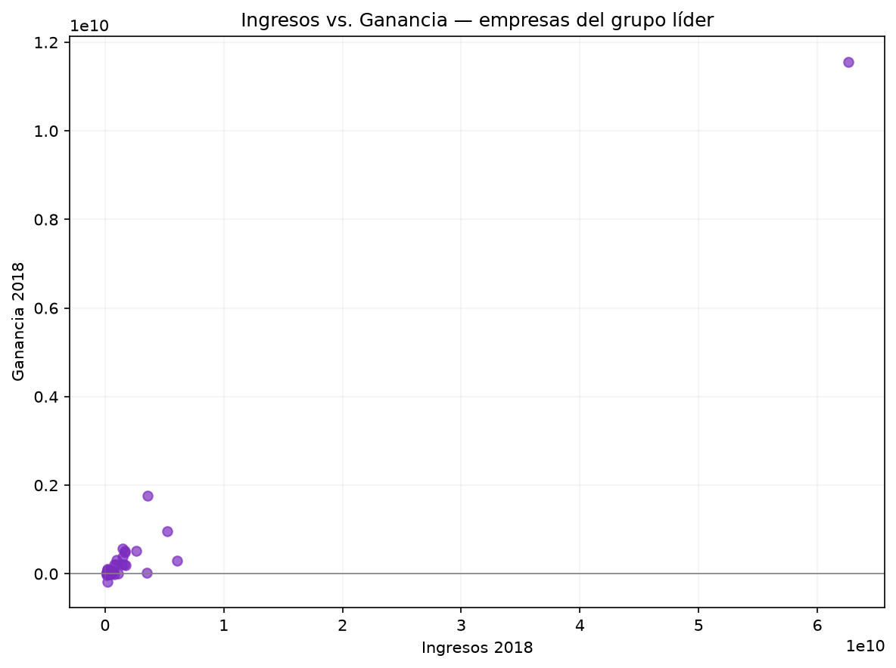
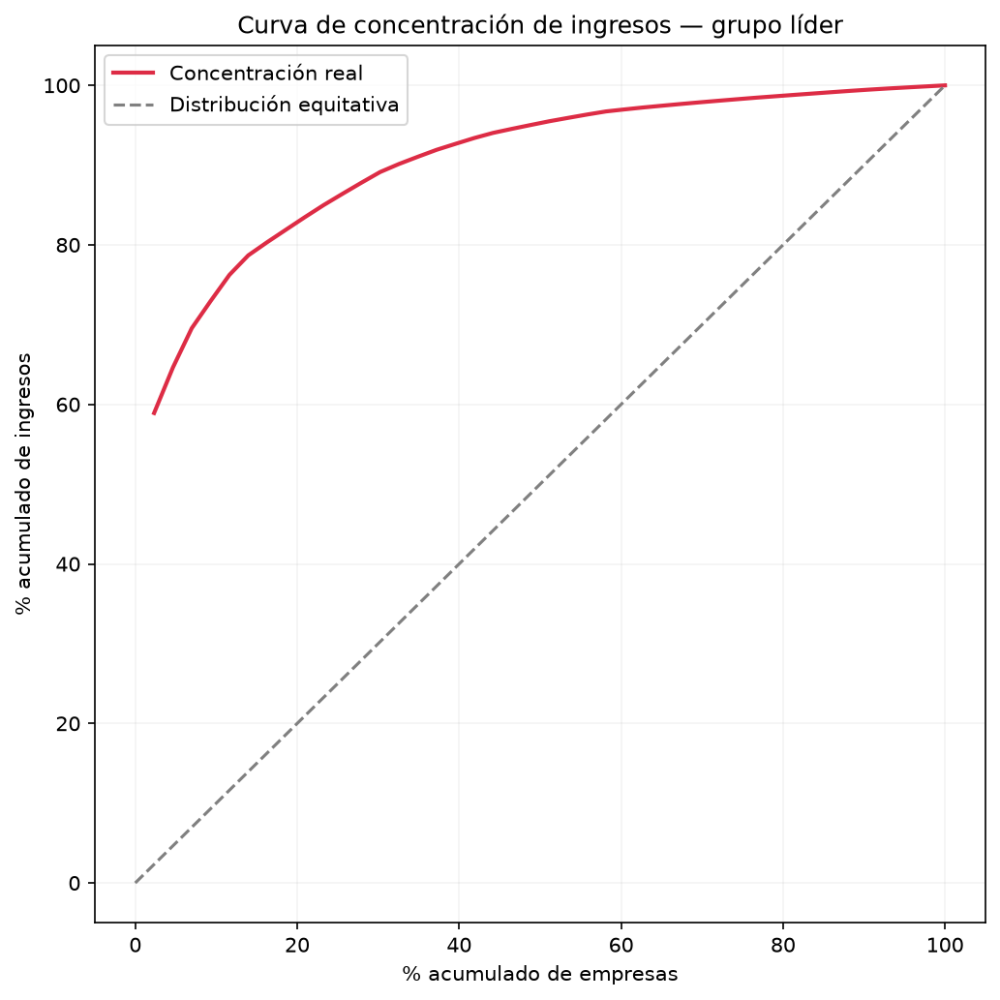

**Español** | [English](results.en.md)

# Informe: Desempeño Financiero de las 1000 Empresas más Grandes de Colombia

**Autora:** Sol Zharick Cruz Ariza
**Periodo analizado:** 2017 – 2018
**Fuente:** [Datos Abiertos Colombia — 1000 Empresas más grandes del país](https://www.datos.gov.co/Econom-a-y-Finanzas/1000-Empresas-mas-grandes-del-pa-s/8hn7-rpp8)

---

## Pregunta de análisis

¿Qué macrosector tuvo el mejor desempeño financiero entre 2017 y 2018, y qué región concentra ese desempeño? Como cierre, ¿qué tan concentrado está ese desempeño en pocas empresas?

---

## 1. Desempeño por macrosector

El macrosector **Minero-Hidrocarburos** lideró el crecimiento entre 2017 y 2018, con un aumento del **25.35% en ingresos** y **80.91% en ganancia** — muy por encima de Construcción (20.98% / 31.87%) y Servicios (16.62% / 74.45%). Manufactura y Agropecuario, pese a tener más empresas, mostraron el menor crecimiento relativo (7.66% y 9.01% respectivamente).

Este boxplot da contexto al hallazgo anterior: Minero-Hidrocarburos también muestra alta dispersión en ingresos, es decir, conviven empresas muy grandes con otras mucho más pequeñas dentro del mismo sector — una señal temprana de la concentración que se confirma más adelante.

## 2. Concentración geográfica

Dentro del macrosector líder, **Bogotá-Cundinamarca concentra 43 de las 54 empresas** y más del 90% de los ingresos del sector — muy por encima de Costa Atlántica (7 empresas) y Antioquia (3 empresas). El liderazgo del sector minero-energético no está distribuido geográficamente; depende casi por completo de una sola región.

## 3. ¿Quiénes son las empresas líderes?

Ecopetrol domina de forma amplia el grupo, seguida por Drummond y Carbones del Cerrejón. Esto confirma que el crecimiento del sector no es un fenómeno generalizado entre muchas empresas medianas, sino que está impulsado por un puñado de compañías de gran escala, la mayoría del sector de hidrocarburos y carbón.

## 4. Ingresos vs. rentabilidad

No todas las empresas con más ingresos son las más rentables — hay dispersión considerable en la relación ingreso/ganancia dentro del grupo líder, lo que sugiere que el tamaño por sí solo no garantiza mejor margen de rentabilidad.

## 5. Concentración de ingresos (cierre)

El hallazgo más contundente del análisis: dentro del grupo líder (Minero-Hidrocarburos en Bogotá-Cundinamarca), el **top 10% de empresas (4 de 43) genera el 72.95% de los ingresos**, y el top 20% (9 empresas) genera el **83.47%**. La curva se aleja fuertemente de la línea de distribución equitativa, confirmando una concentración muy alta.

---

## Conclusión general

El mejor desempeño financiero del país entre 2017 y 2018 se concentró en el macrosector Minero-Hidrocarburos, liderado casi en su totalidad por empresas ubicadas en Bogotá-Cundinamarca. Sin embargo, ese liderazgo no refleja un sector sano y distribuido: depende de un número muy reducido de empresas de gran escala (Ecopetrol a la cabeza), lo que representa un riesgo de concentración — si alguna de estas pocas empresas presenta dificultades, el impacto en las cifras agregadas del sector sería significativo.

## Limitaciones

- El análisis usa datos financieros no consolidados (individuales por empresa), lo que puede subestimar el peso real de grupos empresariales con múltiples filiales.
- Solo cubre 2017-2018; no se puede determinar si la concentración es una tendencia estructural o coyuntural sin datos de años adicionales.
- No se incorporan variables macroeconómicas externas (precio del petróleo, tasa de cambio) que probablemente explican gran parte del crecimiento del sector minero-energético en ese periodo.

